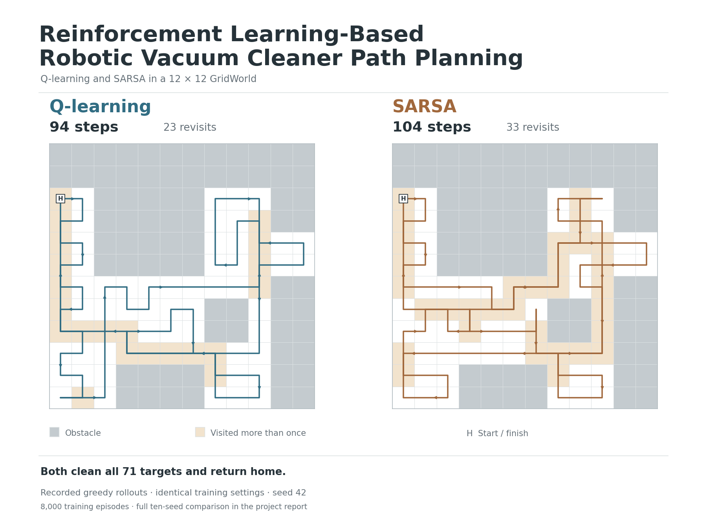
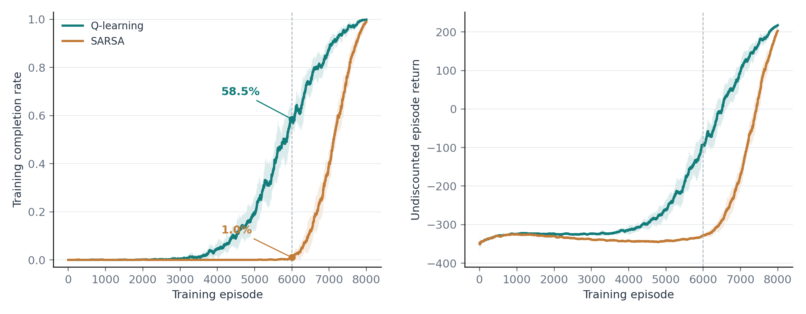
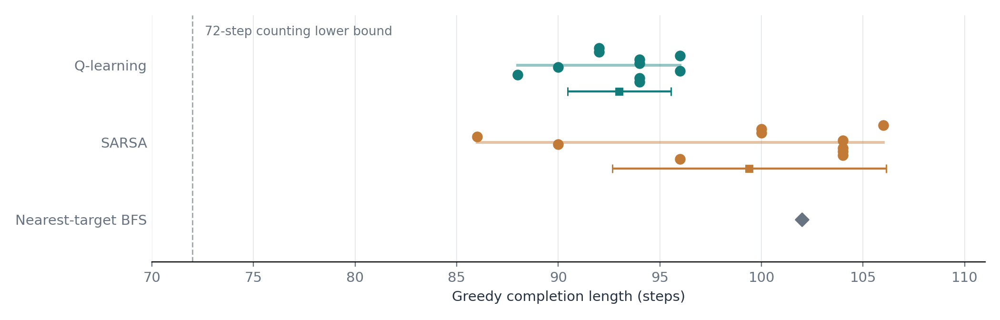

# Reinforcement Learning-Based Robotic Vacuum Cleaner Path Planning

Tabular Q-learning and SARSA for cleaning a fixed 12 x 12 bedroom map and
returning to the starting position. This repository contains a reviewed version
of the Group 9 course project, reproducible experiment logs, and an English
[project portfolio](docs/portfolio.pdf).

[](docs/portfolio.pdf)

[Read the project report (PDF)](docs/portfolio.pdf) · [Watch the simulation (GIF)](docs/figures/comparison_seed42.gif)

The same-setting animation uses seed 42: Q-learning finishes in 94 steps and
SARSA in 104. Tan cells show revisits. All ten seeds, including a SARSA win and
a tie, are included in the aggregate below.

The room has 72 blocked cells and 72 free cells. Home starts clean, leaving
71 target cells. A successful run visits every target and returns home.
The simulator uses a known, deterministic map; it does not operate a physical robot.

## Run the project

Use Python 3.12 for the recorded results. Dependencies are pinned to the versions
used in the review. From this directory:

```bash
python -m venv .venv
# Windows PowerShell: .venv\Scripts\Activate.ps1
# macOS / Linux: source .venv/bin/activate
python -m pip install -r requirements.txt
python -m unittest discover -s tests -v
python -m vacuum_rl --preset portfolio --seeds 789 --out runs/portfolio --render --gif
python tools/verify_reference_runs.py --results runs/portfolio
```

For a quick execution check, add `--episodes 20 --max-steps 100`. This is a smoke
run, not the training configuration behind the published results.

Replay and verify a supplied trajectory without retraining:

```bash
python -m vacuum_rl --replay results/portfolio/qlearning_seed789
```

The GIF is a replay of the recorded evaluation trajectory. It is not a separate,
potentially different policy rollout.

## Verified results

The uploaded portfolio package used **different training settings** for the two
algorithms. Both results below were rerun from the uploaded code and reproduced
action by action by the reviewed implementation.

| Portfolio preset, seed 789 | Episodes | Training step cap | Alpha | Gamma | Greedy steps | Completed |
|---|---:|---:|---:|---:|---:|---|
| Q-learning | 5,000 | 100 | 0.2 | 0.99 | 84 | Yes |
| SARSA | 8,000 | 500 | 0.3 | 0.95 | 96 | Yes |

Both clean all 71 targets and return home with zero collision attempts during
the recorded greedy rollout. Evaluation is capped at 500 steps.
These are selected-configuration demonstrations, not a controlled ranking.

### Matched-setting check

```bash
python -m vacuum_rl --preset matched --seeds 1 2 3 4 5 6 7 8 42 789 --baselines --out runs/matched
```

Both learners use 8,000 episodes, a 500-step training cap, alpha 0.3, gamma 0.95,
and the same exploration schedule and map. Each final policy is evaluated greedily.

| Metric | Q-learning | SARSA |
|---|---:|---:|
| Mean final steps +/- sample SD | 93.0 +/- 2.5 | 99.4 +/- 6.7 |
| Mean moves into previously visited cells | 22.0 | 28.4 |
| Greedy evaluation completion | 10/10 | 10/10 |
| Training completion rate at episode 6,000 | 58.5% | 1.0% |
| First 80% rolling-completion window, mean episode | 6,502 | 7,497 |

Training rates use the last 100 training episodes, averaged across seeds. They
measure the exploratory behavior policy, not a separately evaluated greedy
checkpoint. The 80% milestone is the first full 100-episode window meeting the
threshold; it is not a proof of convergence. All ten runs reach it.

Q-learning averages **6.4% fewer final steps** and **22.5% fewer revisit moves**.
Revisit moves include the required return home. It wins eight paired seeds,
ties one, and loses one; no seed is omitted.



Lines are the mean of 100-episode rolling statistics; shading is one sample
standard deviation across seeds. The largest separation in this check is in
training completion, rather than the final route length.

| Seed | Q-learning steps | SARSA steps |
|---:|---:|---:|
| 1 | 92 | 106 |
| 2 | 92 | 100 |
| 3 | 96 | 100 |
| 4 | 94 | 86 |
| 5 | 94 | 104 |
| 6 | 90 | 90 |
| 7 | 96 | 104 |
| 8 | 88 | 104 |
| 42 | 94 | 104 |
| 789 | 94 | 96 |

The nearest-target BFS heuristic completes the task in 102 steps. The ten
uniform-random action runs fail to finish within the 500-step evaluation cap;
their capped lengths are not completion lengths. Per-seed coverage is recorded
in `results/matched/summary.csv`.
The BFS baseline repeatedly takes a shortest path to the nearest unvisited cell,
then returns home. It knows the complete map and is not an optimal coverage solver.
Q-learning has a shorter mean in this check. Ten seeds on one room do not
establish general superiority or a safety advantage for either algorithm.



The original group report lists 94 Q-learning steps. Its 8,000-episode,
alpha 0.3, gamma 0.95 setup corresponds to the matched preset and yields 94 steps
at seed 789. The later portfolio's 84 steps use the separate configuration above.

## Model

- State: `(position_index, remaining_target_mask)`. The bit mask records the same
  cleaning information as the original flattened dirty map, without storing 144
  entries in every dictionary key.
- Actions: east, west, north, south, indexed 0, 1, 2, 3.
- Every attempted move costs -1, including collisions. First visits to dirty
  cells add +3, so a cleaning move has net reward +2. Successful return adds +100.
- Completion requires zero remaining targets **and** the home position. Hitting
  a step cap is recorded as truncation, not success.
- Sparse float32 Q-values are allocated only for encountered states.

Q-learning uses `r + gamma * max(Q(next_state))`; SARSA uses the next action
sampled from its epsilon-greedy behavior policy. Both use `r` alone at a true
terminal transition. Training caps are external truncations and retain bootstrap
values. The epsilon schedule is `epsilon0 * (N - episode) / N` with zero-based
episode indexing, preserving the uploaded source's behavior.

For source reproducibility, tied Q-values choose the first maximum in E/W/N/S
order. This creates a directional bias and is documented rather than hidden.
The state space remains exponential in the number of target cells; compressing
the key does not solve that scaling limitation.

**72 steps is a counting lower bound:** 71 first visits plus at least one move
back to home. This repository does not prove that a 72-step route exists and does
not claim that any learned route is globally optimal.

## Files and outputs

| Path | Purpose |
|---|---|
| `vacuum_rl/environment.py` | Map validation, transitions, rewards, compact state |
| `vacuum_rl/learning.py` | Shared training loop, Q-learning and SARSA targets |
| `vacuum_rl/evaluation.py` | Read-only greedy evaluation and classical baseline |
| `vacuum_rl/plots.py` | Paths, training figures, trajectory GIFs |
| `tests/` | 14 automated tests, including uploaded reference trajectories |
| `results/portfolio/` | Rerun of the two uploaded portfolio configurations |
| `results/matched/` | Ten-seed comparison, aggregate data, and baselines |
| `docs/REVIEW_NOTES.md` | Findings, scope of changes, and evidence limitations |
| `docs/source_manifest.json` | SHA-256 fingerprints of inspected input code |
| `docs/portfolio.pdf` | English project report with the original title |

Every run saves `metrics.json` (settings, versions, map hash, evaluation metrics),
`training.csv` (one row per episode), `rollout.csv` (one row per action), and
`trajectory.json`. Archived training logs are gzip-compressed as
`training.csv.gz`; newly generated runs use plain CSV. Plots are optional.
`--save-qtable` additionally exports gzip JSONL with masks encoded as strings to
avoid integer precision loss in other tools. No full Q-table is needed to replay
the archived trajectory.

```python
import csv, gzip
with gzip.open("results/matched/qlearning_seed789/training.csv.gz", "rt") as f:
    episodes = list(csv.DictReader(f))
```

## Rebuild the portfolio

```bash
python -m pip install -r requirements-docs.txt
python tools/build_portfolio.py
python tools/build_comparison.py
python tools/build_project_cover.py
```

The PDF and its charts are generated from the included experiment records.
The builder uses DejaVu Sans when installed, falling back to standard PDF fonts.
`python tools/summarize_experiments.py` recomputes all aggregate statistics from
the archived logs. To replace the checked-in experiment suite, copy your complete
matched runs into `results/matched/` first; the aggregator validates their settings.
